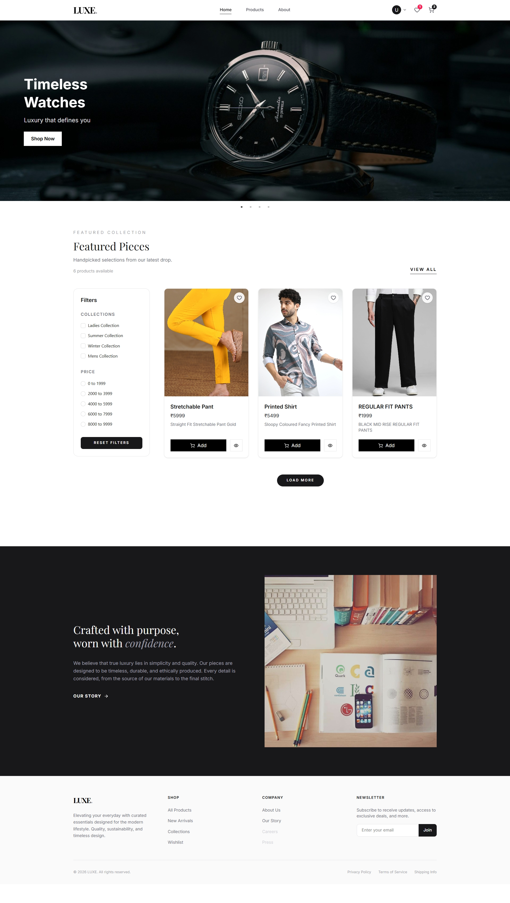
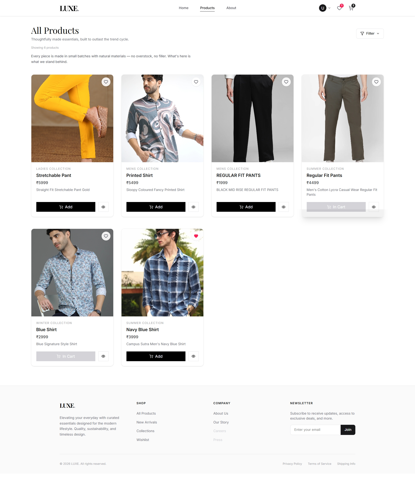
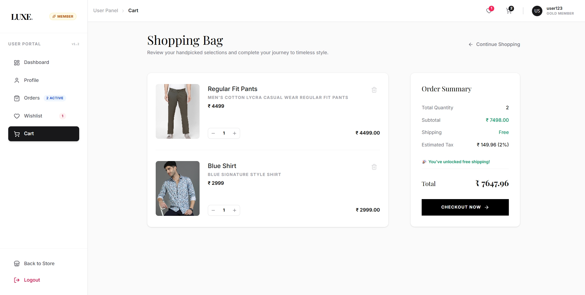
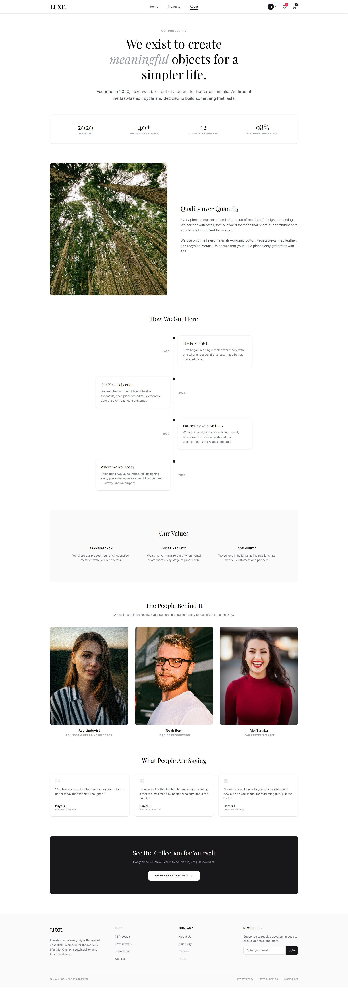

# 🛍️ EcomApp — Full-Stack E-Commerce Platform

EcomApp is a full-stack e-commerce web application built using the MERN stack. It provides a shopping experience where users can browse products, manage their cart and wishlist, authenticate their accounts, and make payments through Razorpay.

The application also includes dedicated user and admin dashboards, with functionality for managing products and collections.

## 🚀 Live Demo

- **Live Website:** [EcomApp](https://ecom-app-teal.vercel.app/)
- **Frontend Hosting:** Vercel
- **Backend Hosting:** Render
- **Database:** MongoDB

> **Project Status:** Deployed and actively being developed. Some features may be improved or extended over time.

---

## 📸 Screenshots

### 🏠 Home Page



### 🛍️ Products Page



### 🛒 Shopping Cart



### ℹ️ About Page



---

## ✨ Features

### 👤 Customer Features

- User registration and login
- Password hashing using bcrypt
- JWT-based authentication
- Protected user routes
- Browse available products and collections
- View individual product details
- Shopping cart and quantity management
- Wishlist management
- Razorpay payment integration
- Payment verification and success-page redirection
- User dashboard and profile management
- Orders page interface
- Responsive user interface and smooth navigation

### 🔐 Admin Features

- Protected admin routes and role-based access control
- Admin dashboard
- Create, update, and delete products
- Product and inventory information management
- Product collection management
- Admin profile interface

### 💳 Payment Features

- Razorpay payment gateway integration
- Backend order creation
- Razorpay Checkout integration
- Server-side payment signature verification
- Payment details retrieval
- Payment success-page redirection

> Note: Payment integration and the orders interface are implemented in the application. A complete persistent order-management workflow may require further development.

---

## 🛠️ Tech Stack

### Frontend

- **React.js** — UI development
- **Vite** — Development server and build tool
- **React Router DOM** — Client-side routing
- **Context API** — Authentication, cart, and wishlist state management
- **Axios** — HTTP requests to the backend
- **Tailwind CSS** — Styling
- **Ant Design** — UI components
- **Framer Motion** — Animations
- **Lucide React** — Icons
- **Sonner** — Toast notifications

### Backend

- **Node.js** — JavaScript runtime
- **Express.js** — REST API and server
- **MongoDB** — Database
- **Mongoose** — Database modeling
- **JWT (JSON Web Tokens)** — Authentication
- **bcrypt** — Password hashing
- **Razorpay SDK** — Payment integration
- **Multer alternative: express-formidable** — Multipart form handling for product management
- **dotenv** — Environment configuration
- **CORS** — Cross-origin request handling

### Deployment

- **Vercel** — Frontend hosting
- **Render** — Backend hosting
- **MongoDB Atlas** — Cloud database hosting, if configured for your deployment

---

## 🏗️ Application Architecture

```text
                 Customer / Admin
                        |
                        v
              React + Vite Frontend
                    (Vercel)
                        |
                  REST API Requests
                        |
                        v
              Node.js + Express API
                    (Render)
                  /      |      \
                 v       v       v
             MongoDB  Auth API  Razorpay
             Database  & Admin  Payments
```

The frontend communicates with the Express backend through REST API endpoints. The backend handles authentication, product and collection operations, database access, and payment-related requests.

---

## 📂 Project Structure

```text
EcomApp/
├── client/                     # React frontend
│   ├── public/                 # Static images and assets
│   ├── src/
│   │   ├── components/         # Reusable UI components
│   │   ├── context/            # Auth, cart, and wishlist contexts
│   │   ├── data/               # Frontend data
│   │   ├── pages/              # Application pages
│   │   │   ├── admin/          # Admin pages
│   │   │   └── user/           # User dashboard pages
│   │   ├── App.jsx              # Application routes
│   │   ├── config.js            # Backend API configuration
│   │   └── main.jsx             # Frontend entry point
│   ├── vercel.json              # SPA routing configuration
│   └── package.json
│
├── src/                         # Backend source
│   ├── config/                  # Environment configuration
│   ├── controllers/             # Request handlers
│   ├── middlewares/             # Authentication middleware
│   ├── models/                  # Mongoose schemas
│   ├── routes/                  # API route definitions
│   └── utils/                   # Utility modules
│
├── public/
│   └── screenshots/              # README screenshots
│
├── server.js                    # Backend entry point
├── package.json                 # Backend dependencies and scripts
└── README.md
```

---

## ⚙️ Getting Started

Follow these steps to run EcomApp locally.

### Prerequisites

Make sure you have installed:

- [Node.js](https://nodejs.org/)
- npm
- A MongoDB database, either local MongoDB or MongoDB Atlas
- A Razorpay account for payment integration

### 1. Clone the Repository

```bash
git clone https://github.com/AljuSabu/EcomApp.git
cd EcomApp
```

### 2. Install Backend Dependencies

From the project root:

```bash
npm install
```

### 3. Install Frontend Dependencies

```bash
cd client
npm install
cd ..
```

### 4. Configure Environment Variables

Create a `.env` file in the **project root**, alongside `server.js` and the root `package.json`.

Add the following variables:

```env
PORT=4000

MONGODB_URL=your_mongodb_connection_string

JWT_SECRET=your_strong_jwt_secret
JWT_EXPIRY=7d

RAZORPAY_KEY_ID=your_razorpay_key_id
RAZORPAY_KEY_SECRET=your_razorpay_key_secret

CLIENT_URL=http://localhost:5173
```

Replace the placeholder values with your own credentials.

**Important:**

- `MONGODB_URL` must contain a valid MongoDB connection string.
- `JWT_SECRET` must be a strong, private secret.
- `RAZORPAY_KEY_ID` and `RAZORPAY_KEY_SECRET` must come from your Razorpay account.
- `CLIENT_URL` should match the frontend origin. For local development, use `http://localhost:5173`.
- Never commit `.env` files or expose private credentials in public repositories.

### 5. Configure the Frontend API URL

Create a `.env` file inside the `client/` directory.

```env
VITE_API_URL=http://localhost:4000/api/v1
```

The frontend uses this variable to communicate with the backend. If it is not defined, the frontend configuration defaults to `http://localhost:4000/api/v1`.

### 6. Run the Application

**Option A: Run the frontend and backend together**

From the project root:

```bash
npm run dev
```

This runs the backend using Nodemon and the frontend using Vite.

**Option B: Run the backend separately**

In the project root:

```bash
npm run backend
```

**Option C: Run the frontend separately**

In a separate terminal:

```bash
npm run frontend
```

The frontend is typically available at `http://localhost:5173`, and the backend uses the port configured in your `.env` file.

---

## ☁️ Deployment Configuration

### Frontend — Vercel

The frontend is deployed at:

**https://ecom-app-teal.vercel.app/**

The frontend uses the `VITE_API_URL` environment variable to connect to the deployed backend.

In Vercel, configure:

```env
VITE_API_URL=https://YOUR-RENDER-BACKEND-URL/api/v1
```

Replace `YOUR-RENDER-BACKEND-URL` with your actual Render service hostname.

The `client/vercel.json` file includes a rewrite rule so that React Router routes, including the payment success page, work when opened directly.

### Backend — Render

The backend is deployed separately as a Node.js web service.

The root `package.json` provides the production start command:

```bash
npm start
```

This executes:

```bash
node server.js
```

Configure the following environment variables in the Render dashboard:

```env
PORT=10000
MONGODB_URL=your_mongodb_connection_string
JWT_SECRET=your_strong_jwt_secret
JWT_EXPIRY=7d
RAZORPAY_KEY_ID=your_razorpay_key_id
RAZORPAY_KEY_SECRET=your_razorpay_key_secret
CLIENT_URL=https://ecom-app-teal.vercel.app
```

Use the port and environment settings required by your hosting provider. Render supplies the `PORT` variable for web services, so the application can use that value.

Do not include the `VITE_API_URL` variable in the backend configuration; it belongs to the frontend.

---

## 🔌 API Overview

The backend API uses the `/api/v1` base path.

| Method | Endpoint                            | Purpose                          |
| ------ | ----------------------------------- | -------------------------------- |
| POST   | `/auth/signup`                      | Register a user                  |
| POST   | `/auth/login`                       | Log in                           |
| POST   | `/auth/logout`                      | Log out                          |
| GET    | `/auth/user-auth`                   | User authentication check        |
| GET    | `/auth/admin-auth`                  | Admin authorization check        |
| GET    | `/product/get-all-products`         | Retrieve products                |
| GET    | `/product/single-product/:slug`     | Retrieve a product by slug       |
| GET    | `/product/product-photo/:id`        | Retrieve product image           |
| POST   | `/product/create-product`           | Create a product (admin)         |
| PUT    | `/product/update-product/:id`       | Update a product (admin)         |
| DELETE | `/product/delete-product/:id`       | Delete a product (admin)         |
| GET    | `/collection/get-all-collection`    | Retrieve collections             |
| POST   | `/collection/create-collection`     | Create a collection (admin)      |
| PUT    | `/collection/update-collection/:id` | Update a collection              |
| DELETE | `/collection/delete-collection/:id` | Delete a collection (admin)      |
| POST   | `/payment/process-payment`          | Create a Razorpay order          |
| GET    | `/payment/get-key`                  | Retrieve the Razorpay public key |
| POST   | `/payment/payment-verification`     | Verify a payment callback        |

**Example:** If the backend is hosted at `https://your-backend.onrender.com`, the full product endpoint is:

```text
https://your-backend.onrender.com/api/v1/product/get-all-products
```

Some endpoints require authentication or admin authorization. Refer to the backend route and middleware files for the exact access requirements.

---

## 🔐 Authentication and Authorization

The application implements authentication and role-based access control.

- User passwords are hashed with bcrypt before being stored.
- JWT-based authentication is used.
- Protected routes restrict access to authenticated users.
- Admin routes use role-based authorization.
- Frontend route guards separate user and admin areas.

Keep authentication secrets private and configure the backend securely before deploying to production.

---

## 💳 Razorpay Payment Integration

EcomApp integrates Razorpay for online payment processing.

The payment flow includes:

1. The frontend requests an order from the backend.
2. The backend creates a Razorpay order.
3. The frontend opens Razorpay Checkout.
4. Razorpay sends the payment callback to the backend.
5. The backend verifies the payment signature.
6. After successful verification, the backend redirects the browser to the frontend payment success page.

The frontend success route is:

```text
/payment/payment-success
```

Payment credentials must be configured through environment variables. Never expose the Razorpay secret key in frontend code.

For a production commerce workflow, payment verification should also be connected to persistent order records, with appropriate validation of order amounts and payment status.

---

## 📱 Responsive User Interface

EcomApp includes a responsive shopping interface with:

- Product cards and product details
- Navigation and footer components
- Shopping cart and wishlist pages
- User and admin dashboards
- Animated UI interactions
- Toast notifications
- Dedicated payment success page

---

## 🚧 Future Improvements

Potential areas for further development include:

- Persistent order creation and order history
- Product search, filtering, and sorting
- Product reviews and ratings
- Stock validation and inventory updates
- Email notifications
- Improved admin analytics
- Coupons and discount functionality
- Additional payment and security checks

---

## 👨‍💻 Author

**Alju Sabu**

- GitHub: [@AljuSabu](https://github.com/AljuSabu)
- Project Repository: [EcomApp](https://github.com/AljuSabu/EcomApp)
- Live Application: [EcomApp on Vercel](https://ecom-app-teal.vercel.app/)

---

## ⭐ Support

If you find this project useful, consider giving the repository a star on GitHub!

Thanks for checking out EcomApp.
